<div align="center">

<picture>
  <source media="(prefers-reduced-motion: reduce)" srcset="docs/media/arkiv-hero.jpg">
  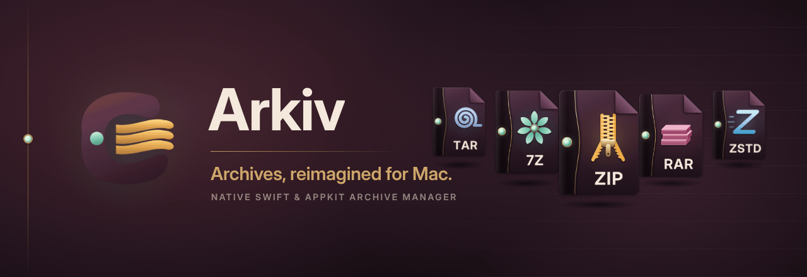
</picture>

<br>

**Arkiv is a native macOS archive manager with the depth of 7-Zip and WinRAR, designed properly for the Mac.**<br>
Browse an archive like a folder, take only what you need, and create, verify and edit archives — in a small Swift and AppKit app.

[**Download**](#download-and-install) &nbsp;·&nbsp; [**User guide**](docs/user-guide.md) &nbsp;·&nbsp; [**Formats**](#supported-formats) &nbsp;·&nbsp; [**Roadmap**](#roadmap) &nbsp;·&nbsp; [**Report an issue**](https://github.com/ish4ra/Arkiv/issues)

[](https://github.com/ish4ra/Arkiv/actions/workflows/macos.yml?query=branch%3Amain)
[](https://github.com/ish4ra/Arkiv/actions/workflows/document-icon-themes.yml?query=branch%3Amain)

<sub>macOS 13 or later &nbsp;·&nbsp; Apple Silicon and Intel &nbsp;·&nbsp; Development builds</sub>

</div>

> [!NOTE]
> **Arkiv is in active early development.** Development builds are ad-hoc signed and **not notarized**, and there is no stable release yet. Several workflows still await validation on a real Mac; see the [feature matrix](docs/feature-matrix.md).

## Why Arkiv

<table>
<tr>
<td width="33%" valign="top">

**Native to the core**<br>
Swift and AppKit throughout: a real Mac table, menus, sheets and shortcuts. No Electron, no web views, no Homebrew.

</td>
<td width="33%" valign="top">

**Light by design**<br>
Bundles only what the default experience needs. Optional content downloads on demand. No background services.

</td>
<td width="33%" valign="top">

**Open without unpacking**<br>
Browse, search, Quick Look and open single files from an archive without extracting the rest.

</td>
</tr>
<tr>
<td valign="top">

**Take only what you need**<br>
Extract a selection or everything, with progress and cancellation. Existing files are never overwritten.

</td>
<td valign="top">

**Create and edit**<br>
ZIP, 7z (AES-256, split volumes), TAR and Zstandard. Add, delete, rename and replace inside eligible ZIP and 7z archives.

</td>
<td valign="top">

**Safety first**<br>
Hostile-path defences, private staging, verified transactional edits and bounded resources, covered by regression tests.

</td>
</tr>
<tr>
<td valign="top">

**Finder integration**<br>
An Arkiv submenu to extract, test and compress, with Services as a fallback.

</td>
<td valign="top">

**Signed in-app updates**<br>
Sparkle verifies every update's EdDSA signature and always asks before installing.

</td>
<td valign="top">

**Document icon themes**<br>
The Seal Dark icons are included. Twenty preserved alternative themes are optional signed downloads.

</td>
</tr>
</table>

<p align="center">
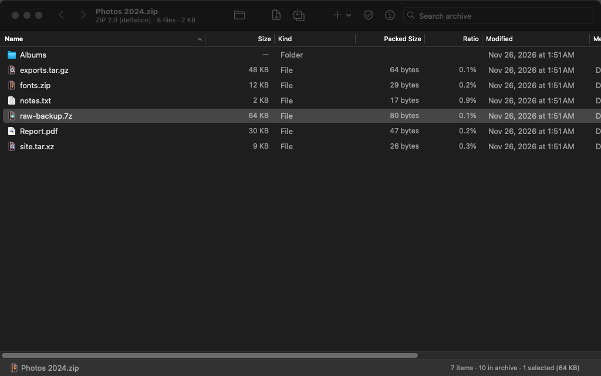
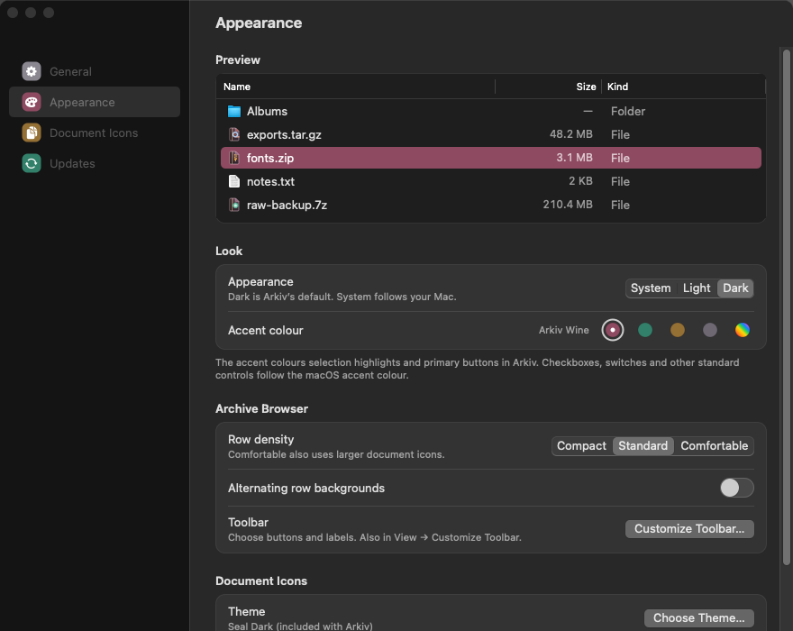
</p>
<p align="center"><sub>Genuine captures of the redesigned windows, rendered on a headless macOS CI runner (not a real-Mac desktop). <a href="docs/screenshots/README.md">All screenshots</a></sub></p>

## Document icons

Arkiv ships one document-icon family, **Seal Dark**, drawn in the same aubergine, brass and jade as the app icon. It covers every format Arkiv registers with macOS:

<p align="center">
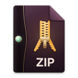
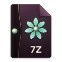

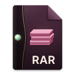
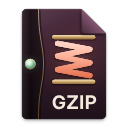
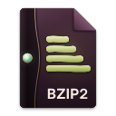
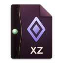
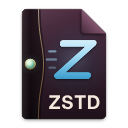
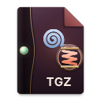
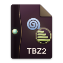
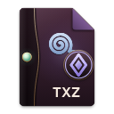
</p>

Every earlier design is preserved as an **optional theme**, downloaded individually from **Settings → Document Icons** rather than bundled with the app. A representative selection, shown from the original archived artwork:

<table>
<tr>
<td align="center" width="25%">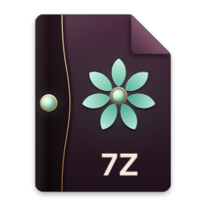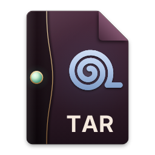<br><sub><b>Restored Readability</b><br>C · Seal</sub></td>
<td align="center" width="25%">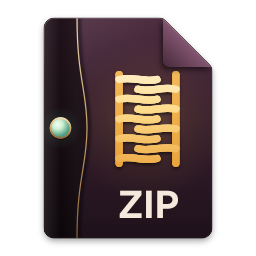<br><sub><b>Original Aubergine</b><br>C · Seal</sub></td>
<td align="center" width="25%">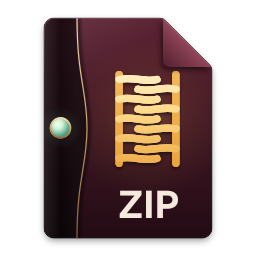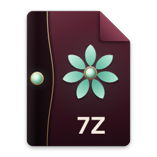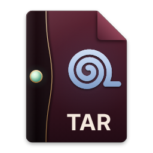<br><sub><b>Seal Wine</b><br>C · Seal</sub></td>
<td align="center" width="25%">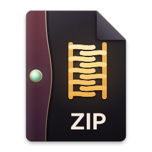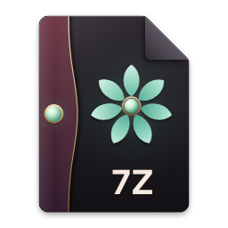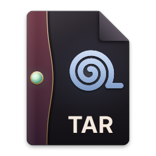<br><sub><b>Seal Noir</b><br>C · Seal</sub></td>
</tr>
<tr>
<td align="center">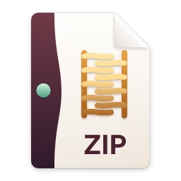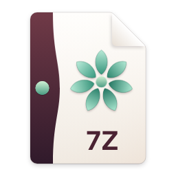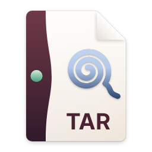<br><sub><b>Seal Original</b><br>C · Seal</sub></td>
<td align="center">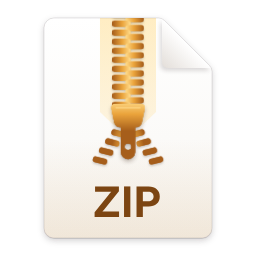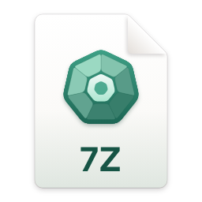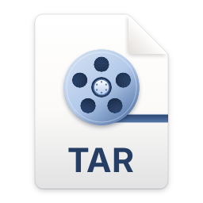<br><sub><b>Folio</b><br>A · Folio</sub></td>
<td align="center">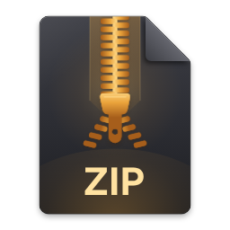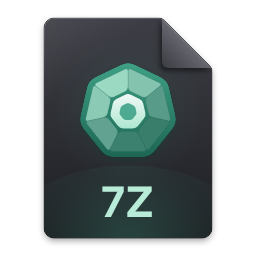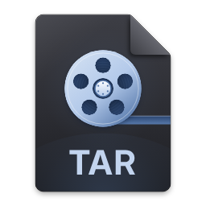<br><sub><b>Folio Dark</b><br>A · Folio</sub></td>
<td align="center">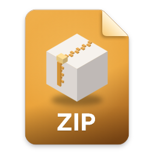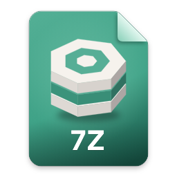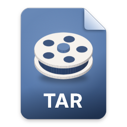<br><sub><b>Strata</b><br>B · Strata</sub></td>
</tr>
</table>

The full set is 20 themes: these eight, the original partial **Classic** icons (ZIP, 7z, TAR and RAR only) and 11 design variations. The [theme inventory](docs/document-icon-theme-inventory.md) lists each one's source and download size (0.54–8.86 MB).

- **Inside Arkiv**, a selected theme changes archive rows, the window's proxy icon, the path bar, recent archives and Archive Info immediately, in every open window, without reopening anything.
- **In Finder and Get Info**, documents keep the bundled Seal Dark icons, shown while Arkiv is the default app for that type. macOS reads them from the signed app; Arkiv never modifies its bundle or changes your default apps. A Quick Look thumbnail extension is being evaluated as a prototype ([feasibility report](docs/quicklook-thumbnail-feasibility.md)).
- Themes are verified against a signed catalogue, stored outside the app, and keep working offline once installed.

> [!NOTE]
> **Theme downloads are live.** The signed production catalogue and all 20 packs are published, and development build 30701 contains the production key. The maintainer has loaded the catalogue and downloaded and applied Folio Dark on an Apple Silicon Mac; the complete real-Mac acceptance list is still open. [Details](docs/document-icon-themes.md).

## Supported formats

A format is listed only once automated fixture tests pass. Recognising an extension does not mean every method inside it works.

| Format | Browse & extract | Create | Edit | Encryption | Test | Split volumes |
| :-- | :-- | :-- | :-- | :-- | :-- | :-- |
| 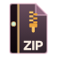 **ZIP** | Store, Deflate | Yes, the default | Yes¹ | AES-256² | Data, CRC, AES | — |
| 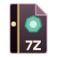 **7z** | LZMA, LZMA2 | LZMA2 | Yes³ | AES-256, names too | Data, CRC | Read, create⁴ |
| 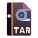 **TAR**⁵ | Yes | Yes | — | — | Structure⁶ | — |
| 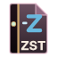 **Zstandard**⁵ | One frame | Yes | — | — | Checksum⁷ | — |
|  **GZIP, BZIP2, XZ** | One file | One file | — | — | Full stream | — |
| 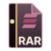 **RAR4, RAR5** | Verified variants⁸ | Never | Never | — | Full CRC | Planned |

<p><sub>
¹ Add, delete, rename, new folder, replace and update files and folders, in ordinary single-disk ZIP32 without encryption; encrypted, ZIP64 and multipart ZIPs are read-only.<br>
² AES-256 creation with visible filenames; AES-128/192/256 reading (WinZip AE-1/AE-2).<br>
³ Add, delete, rename and replace a file in single-volume, non-solid 7z with supported methods and metadata, including eligible encrypted archives; solid and split 7z are read-only.<br>
⁴ <code>.7z.001</code> sets of 2–128 parts, up to 4 GiB.<br>
⁵ TAR includes <code>.tar.gz</code>/<code>.tgz</code>, <code>.tar.bz2</code>/<code>.tbz2</code> and <code>.tar.xz</code>/<code>.txz</code>; Zstandard covers <code>.zst</code>, <code>.tar.zst</code> and <code>.tzst</code>. Single compressed stream only.<br>
⁶ TAR has no per-entry checksum, so a passing test is reported as a warning; compressed wrappers are checked separately.<br>
⁷ A frame without a checksum produces a warning.<br>
⁸ RAR4 Store/Normal/Best and RAR5 stored/compressed; encrypted, solid and multipart RAR are rejected (<a href="docs/rar-compatibility.md">RAR matrix</a>).
</sub></p>

**Not supported:** RAR creation, encrypted ZIP editing, ZIP64 AES, legacy ZipCrypto, split ZIP, Zstandard dictionaries and multi-frame streams, ZIPX and disk images. Details: [format evidence](docs/archive-formats.md) · [ZIP AES](docs/zip-aes.md) · [7z](docs/sevenzip.md) · [split 7z](docs/multipart.md) · [compressed TAR](docs/compressed-tar.md) · [Zstandard](docs/zstandard.md) · [standalone compression](docs/standalone-compression.md).

## Download and install

<p align="center"><a href="https://github.com/ish4ra/Arkiv/releases/tag/dev-30701"><b>Download Arkiv development build 30701</b></a> &nbsp;·&nbsp; Universal &nbsp;·&nbsp; macOS 13 or later<br><sub><a href="https://github.com/ish4ra/Arkiv/releases?q=Arkiv+Development&amp;expanded=true">All Arkiv application builds, newest first</a> (excludes document icon theme packs)</sub></p>

There is no stable release yet. **Universal** builds run on both Apple Silicon and Intel Macs; **arm64** builds run on Apple Silicon only.

| Option | Best for | Where |
| --- | --- | --- |
| **Signed development release** (Universal) | The quickest first install, on any supported Mac; no GitHub account needed | [Arkiv application builds](https://github.com/ish4ra/Arkiv/releases?q=Arkiv+Development&expanded=true): open the newest **Arkiv Development _build_** (currently [`dev-30701`](https://github.com/ish4ra/Arkiv/releases/tag/dev-30701)) and download `Arkiv-universal.zip` |
| **Development DMG** (arm64 or Universal) | A smaller Apple Silicon–only build, or a disk image | [macOS foundation runs on `main`](https://github.com/ish4ra/Arkiv/actions/workflows/macos.yml?query=branch%3Amain+is%3Asuccess) → **Artifacts** (sign in to GitHub): `Arkiv-arm64-development-dmg` or `Arkiv-universal-development-dmg`, each with a SHA-256 checksum |
| **In-app updates** | Staying current after the first install | **Arkiv → Check for Updates…** |

The full Releases page also lists document icon theme packs (`document-icon-themes-v*`). Those are not Arkiv builds and cannot be installed as an app: choose a release named **Arkiv Development** (tag `dev-<build>`), or use the link above, which lists only application builds. GitHub's generic “latest release” link is not used because every Arkiv build is a prerelease. How these links are kept current: [download links](docs/release.md#download-links).

**First installation**

1. Optionally check the download: the release page shows a SHA-256 digest next to each file; compare it with `shasum -a 256 Arkiv-universal.zip`. For an Actions artifact, unzip GitHub's wrapper first, then run `shasum -a 256 -c Arkiv-*-development.dmg.sha256`. Then unzip the download.
2. Drag **Arkiv.app** to **Applications** and open it from there.
3. These builds are ad-hoc signed, not Developer ID signed, and **not notarized**, so macOS may say it could not verify Arkiv. If you trust this repository, try to open Arkiv once, then choose **System Settings → Privacy & Security → Open Anyway**. Do not disable Gatekeeper globally. See [signing, notarization and Gatekeeper](docs/release.md#signing-notarization-and-gatekeeper).

**Updates:** after that, **Check for Updates…** downloads the newest `Arkiv-universal.zip` and installs it only after Sparkle verifies its EdDSA signature against the key built into Arkiv, and only with your confirmation. This proves an update came from this project; it is not Apple notarization. See [development updates](docs/updates.md).

## Safety and privacy

- **Your archive is never modified** by browsing, testing or extracting. Edits are transactional and verified before they replace the original.
- **Extraction stays inside the folder you choose.** Path traversal, absolute paths, link tricks and unsafe special files are rejected, and output is staged privately before it is published.
- **No silent overwrites.** Extraction, creation and Finder actions never replace or merge existing files.
- **Bounded resources.** Extraction is capped at 100,000 entries and 20 GiB of output.
- **Passwords are never stored**, logged or passed through URLs. Opening an encrypted archive decodes it to a private temporary file that is deleted on normal cleanup; a crash can leave it behind, and deletion is not secure erasure.
- **No account, telemetry or background service.** Arkiv contacts the network only for:
  - **Updates:** Sparkle's update checks (on request, or on a schedule only if you allow it) and update downloads.
  - **Document icon themes:** the signed theme catalogue, requested only while **Settings → Document Icons** is shown or when you choose Refresh Catalogue; preview images for the theme you are viewing (never for the whole list); and a theme pack, only when you click Download. Installed themes work offline.

These protections have known limits. For example, the Finder extension's handoff does not authenticate its sender, and extended attributes and timestamps are not restored. See [security and known limits](docs/security.md).

## Roadmap

| State | What |
| --- | --- |
| **Published** in development build 30701 | Archive browser, search and Quick Look · extraction · ZIP, 7z, TAR and Zstandard creation · ZIP and 7z editing · split 7z · RAR reading · Finder integration · signed Sparkle updates · Settings · document icon themes with the production catalogue (20 themes) |
| **In review** | Complete UI redesign: welcome window, archive window, sidebar Settings, theme gallery, accent and density customization ([design](docs/ui-redesign.md)) · Quick Look thumbnail prototype and Finder feasibility report |
| **Awaiting real-Mac validation** | The redesigned interface · complete theme acceptance (persistence, offline, removal, every in-app icon) · broader Finder extension acceptance · Finder rendering of the document icons · app icon at Dock and Finder sizes · ZIP and TAR associations |
| **Next** | Redesign acceptance and release → 5 · RAR multipart reading → 6 · Split ZIP → 7 · Public beta hardening → 8 · Community launch → remaining archive-engine work ([public beta plan](docs/public-beta-plan.md)) |
| **Planned** | More RAR methods, encrypted ZIP editing, editing more formats, archive comments · checksums, split/combine, benchmark, command-line companion · a Quick Look extension for archives · Developer ID signing and notarization |

The complete queue is in the [roadmap](docs/roadmap.md), the current state of every feature in the [feature matrix](docs/feature-matrix.md), and the full plan in the [specification](ARKIV_SPEC.md).

## Build from source

Requires macOS 13 or later, the Xcode command-line tools with Swift 5.9+, and Python 3 for the fixture tests.

```sh
python3 scripts/build-sevenzip.py
swift test -Xlinker -L"$PWD/.build/sevenzip" -Xlinker -rpath -Xlinker "$PWD/.build/sevenzip"
scripts/test-engine.sh
scripts/build-app.sh
scripts/build-dmg.sh
open build/Arkiv-arm64-development.dmg
```

The app builds for arm64 by default; set `ARKIV_ARCH=universal` for both build scripts to produce a Universal app. On Linux you can build and test the archive engine (`ArkivCore`), but not the AppKit app.

Arkiv is a Swift package: an AppKit app (`ArkivApp`) on a UI-independent engine (`ArkivCore`) that a future command-line tool can reuse. ZIP, TAR and RAR use the system libarchive; 7z uses a pinned build of the official 7-Zip source with the RAR code excluded. Arkiv never shells out to external tools. See [architecture](docs/architecture.md) and [release and build details](docs/release.md).

## Documentation

| | |
| --- | --- |
| **Using Arkiv** | [User guide](docs/user-guide.md) · [Settings](docs/settings.md) · [Finder Sync](docs/finder-sync.md) · [Services fallback](docs/finder-integration.md) · [Updates](docs/updates.md) |
| **Formats** | [Format evidence](docs/archive-formats.md) · [Feature matrix](docs/feature-matrix.md) · [Creation](docs/creation.md) · [ZIP edits](docs/zip-edits.md) · [7z](docs/sevenzip.md) · [RAR](docs/rar-compatibility.md) · [Integrity](docs/integrity.md) |
| **Document icons** | [Document icons](docs/document-icons.md) · [Themes](docs/document-icon-themes.md) · [Theme inventory](docs/document-icon-theme-inventory.md) · [Format icon coverage](docs/format-icon-coverage.md) · [Branding](branding/README.md) |
| **Safety** | [Security and limits](docs/security.md) · [Extraction compatibility](docs/extraction-compatibility.md) |
| **Development** | [Architecture](docs/architecture.md) · [Release and builds](docs/release.md) · [Roadmap](docs/roadmap.md) · [Specification](ARKIV_SPEC.md) · [README media](docs/media/README.md) · [UI redesign](docs/ui-redesign.md) |
| **Releasing** | [Real-Mac acceptance](docs/real-mac-acceptance.md) · [Public beta plan](docs/public-beta-plan.md) · [Licence assessment](docs/licensing-assessment.md) · [Quick Look feasibility](docs/quicklook-thumbnail-feasibility.md) |

Found a problem? [Open an issue](https://github.com/ish4ra/Arkiv/issues) with your macOS version, Mac model, Arkiv build (Arkiv → About Arkiv) and the steps to reproduce it. Please never attach archives that contain private data or passwords.

## Licensing

**Arkiv has not selected a project-wide licence yet**, and the repository has no root `LICENSE` file.

Third-party components keep their own licences:

- **7-Zip:** Arkiv bundles a library built from a pinned subset of the official 7-Zip 26.04 source, under LGPL-2.1-or-later (some files public domain), with no RAR code. Arkiv's bridge to this library is also LGPL-2.1-or-later. Source and rebuild instructions are in [`Vendor/7zip`](Vendor/7zip/README.md) and the [7z backend](docs/sevenzip.md) notes.
- **libarchive:** Arkiv uses the macOS system copy. Its BSD-licensed headers are included for building.
- **Sparkle 2.10.0:** bundled for updates. Its licence file is included in the app.
- **Inter Display 4.0** (SIL Open Font License 1.1, [`OFL.txt`](design/document-icons/fonts/OFL.txt)) renders document-icon and README-banner lettering at design time; no font is bundled in the app.

See [third-party notices](docs/third-party-licenses.md).
